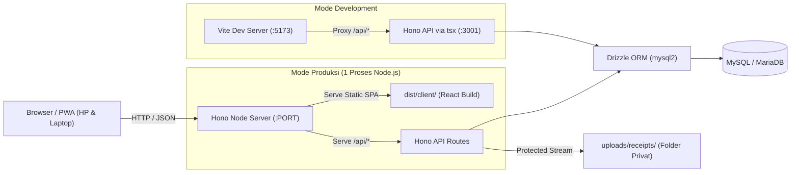

# 01. Arsitektur Sistem

## 1. Gambaran Umum
**MoneyTrack** dibangun sebagai aplikasi **Fullstack TypeScript** dalam satu repositori terpadu agar ringan dijalankan di shared hosting (Runtime Manager Node.js) sekaligus nyaman dipelajari tanpa kompleksitas monorepo multi-paket.



## 2. Stack Teknologi Inti

| Lapisan | Teknologi | Alasan Pemilihan |
| --- | --- | --- |
| **Frontend UI** | React 19 + TypeScript + Vite | Ekosistem matang, HMR cepat saat dev, output statis ringan untuk PWA. |
| **Styling & Tipografi** | Tailwind CSS v4 + `@fontsource/inter` | Desain responsif konsisten tanpa CSS terpisah; font `Inter` dibundel lokal agar tetap tampil cepat saat offline. |
| **Backend API** | Hono + `@hono/node-server` | Sangat hemat RAM, sintaks ringkas, mendukung middleware TypeScript dan static file serving sekaligus. |
| **ORM & Database** | Drizzle ORM + `mysql2` (MySQL / MariaDB) | Ringan tanpa binary engine berat; kompatibel dengan Laragon dan mayoritas shared hosting. |
| **Validasi & Tipe Bersama** | React Hook Form + Zod (`src/shared`) | Validasi form wajib di UI (`zodResolver`) sekaligus validasi payload API memakai skema yang sama. |
| **Testing** | Vitest | Menguji utilitas TypeScript dan endpoint Hono di memori tanpa harus menyalakan server port. |

## 3. Struktur Direktori

```text
app-MoneyTracking/
├── docs/                  # Dokumentasi arsitektur, DB, UX, API, dan roadmap
├── drizzle/               # File migrasi SQL hasil generate Drizzle Kit
├── public/                # Aset statis PWA (manifest.webmanifest, icon.svg)
├── src/
│   ├── client/            # Aplikasi React (.tsx) dan styling Tailwind
│   │   ├── components/    # Komponen UI modular
│   │   ├── App.tsx        # Shell utama (Sidebar desktop + Bottom Nav mobile)
│   │   ├── index.css      # Konfigurasi tema Tailwind & font Inter
│   │   └── main.tsx       # Entry point React + import fontsource Inter
│   ├── server/            # Server Hono (.ts)
│   │   ├── config/        # Validasi environment variable (Zod)
│   │   ├── db/            # Koneksi pool MySQL dan skema tabel Drizzle
│   │   ├── app.ts         # Registrasi route Hono & static fallback produksi
│   │   └── index.ts       # Bootstrapping Node HTTP server
│   └── shared/            # Kode murni TypeScript lintas client & server
│       ├── types/         # Tipe domain (Workspace, Role, Visibility, Currency)
│       ├── utils/         # Quick input parser & helper mata uang minor-unit
│       └── validation/    # Skema Zod bersama untuk React Hook Form & API
├── drizzle.config.ts      # Konfigurasi Drizzle Kit
├── tsconfig.*.json        # Pemisahan typecheck client (DOM) dan server (Node)
├── vite.config.ts         # Build client + proxy /api di mode development
└── vitest.config.ts       # Konfigurasi test runner
```

## 4. Pemisahan TypeScript Client vs Server
Agar kode frontend tidak tidak sengaja memanggil modul Node.js (`fs`, `mysql2`) dan kode server tidak mengakses API browser (`window`, `document`), pengecekan tipe dibagi dua:
- `tsconfig.client.json` mengecek `src/client/**` dan `src/shared/**` dengan target DOM.
- `tsconfig.server.json` mengecek `src/server/**` dan `src/shared/**` dengan target Node.js.
- Kedua konfigurasi dijalankan bersama lewat `npm run typecheck`.

## 5. Prinsip Keamanan & Integritas Data
1. **Session Cookie `HttpOnly`:** Autentikasi memakai session tersimpan di tabel `sessions` agar token tidak mudah dicuri via XSS.
2. **Otorisasi Berbasis Workspace:** Setiap endpoint yang mengakses data ruang keuangan wajib memverifikasi keanggotaan di `workspace_members` dan role pengguna.
3. **Penyimpanan Struk Privat:** File foto struk tidak diletakkan di `public/`. File disimpan di `UPLOAD_DIR` (`./uploads/receipts`) dan hanya dikirimkan lewat endpoint API setelah verifikasi akses workspace.
4. **Aritmetika Presisi Uang:** Seluruh nominal disimpan sebagai integer *minor unit* (`BIGINT`) agar bebas error pembulatan *floating point*.
