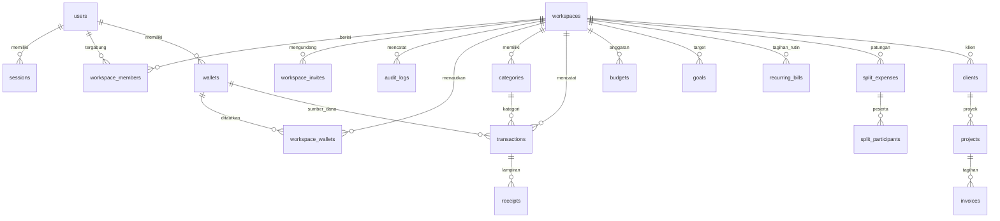

# 02. Desain Database

Basis data menggunakan **MySQL / MariaDB** yang dikelola melalui **Drizzle ORM** (`src/server/db/schema/`). Saat ini sudah terdapat **19 tabel inti** pada migrasi awal [0000_zippy_shooting_star.sql](../drizzle/0000_zippy_shooting_star.sql).

## 1. Diagram Relasi Entitas (ERD Ringkas)

## 2. Pengelompokan 19 Tabel

### A. Autentikasi (`schema/auth.ts`)
- `users`: Data akun pengguna (`email` unik, `password_hash` opsional jika daftar via Google, `google_id` unik, `avatar_url`).
- `sessions`: Sesi login aktif dengan masa berlaku `expires_at`.

### B. Multi-Workspace & Tata Kelola (`schema/workspaces.ts`)
- `workspaces`: Ruang keuangan dengan `type` (`personal` | `shared` | `business`) dan `primary_currency`. Kolom kustomisasi `icon` (kunci ikon, VARCHAR 40) dan `color` (hex `#RRGGBB`, VARCHAR 20) boleh `NULL` = tampilan bawaan sesuai mode.
- `workspace_members`: Penghubung `users` dan `workspaces` beserta `role` (`owner` | `admin` | `member` | `viewer`).
- `workspace_invites`: Undangan gabung via token link atau email dengan role awal dan `expires_at`.
- `audit_logs`: Rekaman aksi (`create`, `update`, `delete`, `settle`) lengkap dengan `actor_user_id` dan `metadata_json`.

### C. Keuangan Inti & Kolaborasi (`schema/finance.ts`)
- `wallets`: Dompet/rekening fisik milik user (`cash`, `bank`, `ewallet`, `investment`, `other`), mata uang sendiri (`currency_code`), dan `balance_minor`. Kolom `icon` & `color` (nullable, diatur pemilik dompet; `NULL` = bawaan sesuai jenis) berlaku di semua Workspace tempat dompet ditautkan.
- `workspace_wallets`: Relasi many-to-many antara Workspace dan Dompet dengan `visibility_mode`:
  - `workspace_only`: Saldo dompet sinkron, tetapi mutasi hanya tampak di Workspace pembuat transaksi.
  - `full_transparent`: Saldo dan seluruh mutasi dompet terlihat di semua Workspace yang menautkannya.
- `categories`: Kategori pemasukan dan pengeluaran per Workspace.
- `transactions`: Catatan `income`, `expense`, dan `transfer` (`transfer_target_wallet_id`). Menyimpan `amount_minor` dalam mata uang dompet, `exchange_rate_to_workspace`, dan `converted_amount_minor` dalam mata uang utama Workspace.
- `receipts`: Metadata lampiran foto struk yang tersimpan di disk privat server.
- `budgets`: Batas anggaran per kategori per bulan (`month_key` format `YYYY-MM`).
- `goals`: Target tabungan/dana darurat beserta progres `current_minor`.
- `recurring_bills`: Jadwal pemasukan/pengeluaran rutin (`weekly`, `monthly`, `yearly`) dengan `next_due_date` untuk pengingat konfirmasi 1-klik.
- `split_expenses` & `split_participants`: Pengeluaran patungan yang mencatat siapa menalangi (`paid_by_user_id`), porsi masing-masing anggota (`owed_minor`), jumlah terlunasi (`settled_minor`), dan status `is_settled`.

### D. Freelancer & UMKM (`schema/business.ts`)
- `clients`: Daftar klien/pelanggan per Workspace bisnis.
- `projects`: Proyek/pekerjaan terkait klien (`active`, `completed`, `paused`) dan estimasi `budget_minor`. Transaksi dapat ditautkan ke `project_id` untuk menghitung profit bersih per proyek.
- `invoices`: Tagihan ke klien (`draft`, `sent`, `partial`, `paid`, `overdue`) beserta pelacakan `paid_minor` dan `due_date`.

## 3. Aturan Penting Skema & Kompatibilitas

### A. Multi-Currency & Minor Units
Untuk mencegah error presisi angka desimal (`0.1 + 0.2`), nominal disimpan dalam satuan terkecil (*minor unit*) bertipe `BIGINT`:
- `IDR` (0 desimal): `Rp25.000` disimpan sebagai `25000`.
- `USD`, `SGD`, `MYR`, `EUR` (2 desimal): `$12.50` disimpan sebagai `1250`.

### B. Kompatibilitas MariaDB 10.1+ & MySQL 5.7+
Agar skema berjalan lancar di lingkungan Laragon lama (`10.1.25-MariaDB`) maupun shared hosting:
1. Seluruh kolom waktu otomatis menggunakan `DEFAULT CURRENT_TIMESTAMP` lewat helper [helpers.ts](../src/server/db/schema/helpers.ts) (tidak memakai `DEFAULT (now())`).
2. Kolom tanggal transaksi/jatuh tempo memakai tipe `DATETIME` untuk menghindari batasan `explicit_defaults_for_timestamp`.
3. Kolom berindeks unik (`email`, `google_id`) dibatasi maksimal `varchar(191)` agar aman untuk indeks `utf8mb4`.
4. **Zona waktu:** Drizzle membaca/menulis DATETIME & TIMESTAMP sebagai UTC, sehingga setiap koneksi menjalankan `SET time_zone = '+00:00'` ([db/index.ts](../src/server/db/index.ts)) agar nilai `DEFAULT CURRENT_TIMESTAMP` juga UTC. Tanggal tanpa jam (jatuh tempo, tenggat, terbit invoice) disimpan sebagai pukul 12:00 lokal lewat `dateKeyToDate`.
5. Migrasi [0001_clumsy_juggernaut.sql](../drizzle/0001_clumsy_juggernaut.sql) menambah indeks unik nomor invoice per Workspace (`uq_invoice_number`) serta indeks `transactions.project_id` & `invoice_id`.
6. Eksekusi perubahan database menggunakan **`npm run db:migrate`** (migrasi SQL deterministik), bukan `drizzle-kit push` yang bergantung pada tabel sistem MySQL 8 (`check_constraints`).
