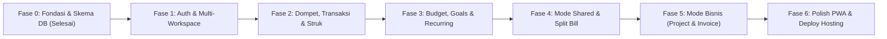

# 05. Roadmap Pengembangan

Roadmap disusun bertahap agar setiap fase langsung menghasilkan fitur yang bisa diuji dan dipakai, sekaligus nyaman untuk proses belajar TypeScript.

## Ringkasan Fase

---

## Fase 0 — Fondasi Project & Skema Database *(Selesai)*
- [x] Setup Fullstack TypeScript (Vite + React + Tailwind v4 + font `Inter` + Hono + Drizzle MySQL).
- [x] Utilitas `src/shared/` (`QuickInput` parser dan helper mata uang *minor unit*).
- [x] Desain & migrasi 19 tabel awal ke MariaDB/MySQL (`0000_zippy_shooting_star.sql`).
- [x] Shell UI responsif + endpoint `GET /api/health` dan `POST /api/utils/parse-quick-input`.

## Fase 1 — Autentikasi & Multi-Workspace Inti *(Selesai)*
- [x] Manajemen `sessions` dengan cookie `HttpOnly` dan token SHA-256.
- [x] Halaman Login/Daftar minimal via **Google OAuth** + provisioning **Workspace Pribadi** awal.
- [x] Middleware otorisasi session (`requireAuth`) dan keanggotaan/role Workspace (`requireWorkspaceRole`).
- [x] CRUD Workspace (`Personal`, `Shared`, `Business`) beserta kategori default per mode + UI buat/ubah/hapus di Workspace Switcher.
- [x] Sistem undangan anggota (`workspace_invites`) via link sekali pakai (opsional dikunci ke email), halaman `/invite/<token>`, dan daftar anggota.
- [x] Ubah role / keluarkan anggota / keluar sendiri (dikerjakan di Fase 4 bersama Audit Log).

## Fase 2 — Dompet Lintas Ruang, Transaksi Inti & Upload Struk *(Selesai)*
- [x] CRUD Dompet (`wallets`) dengan mata uang masing-masing + penautan ke Workspace (`workspace_wallets`) dan toggle `visibility_mode` (`workspace_only` / `full_transparent`, hanya oleh pemilik dompet).
- [x] Pencatatan Pemasukan, Pengeluaran, dan Transfer antar dompet dalam DB transaction atomik (menjaga sinkronisasi saldo), termasuk edit/hapus yang membalik saldo + `audit_logs`.
- [x] Konversi mata uang dompet ke mata uang utama Workspace saat transaksi dicatat (kurs manual, aritmetika integer). Transfer beda mata uang belum didukung.
- [x] Integrasi **Quick Input** ke form transaksi nyata (autofill hasil parse + pencocokan dompet + edit sebelum simpan).
- [x] Upload foto struk dengan kompresi otomatis di browser (WebP, maks. 1600px) dan route unduh privat berautentikasi.

## Fase 3 — Manajemen Keuangan Pribadi (Budget, Goals & Recurring) *(Selesai)*
- [x] Modul **Budgeting per Kategori** bulanan lengkap dengan progress bar, peringatan ≥ 80% (dashboard), salin dari bulan lalu, dan kelola kategori kustom.
- [x] Modul **Goals / Target Tabungan**: setor/tarik atomik, riwayat setoran, dan kebutuhan setoran per bulan dari tenggat.
- [x] Modul **Tagihan Rutin / Recurring** dengan kartu pengingat jatuh tempo (≤ 7 hari) & tombol **Konfirmasi Bayar 1-Klik** (form pre-filled, jatuh tempo maju atomik), plus Lewati periode.

## Fase 4 — Kolaborasi Pasangan & Komunitas (`shared`) *(Selesai)*
- [x] Pencatatan **Kas Bersama** dan ringkasan kontribusi anggota per bulan.
- [x] Fitur **Split Bill** (bagi rata maupun nominal custom) dan **Settlement** netto per pasangan (*siapa transfer ke siapa*), dikonfirmasi oleh penerima uang.
- [x] Halaman **Audit Log** untuk melacak histori transaksi, split, anggota, dompet, target, dan pengaturan oleh tiap anggota.

## Fase 5 — Freelancer & UMKM (`business`) *(Selesai)*
- [x] Manajemen **Klien** dan **Project** (menghubungkan transaksi pemasukan/biaya ke project tertentu, anggaran biaya project).
- [x] Dashboard **Profit per Project / Klien** (Omzet − Biaya Operasional = Profit Bersih) + piutang per klien.
- [x] Pelacakan **Invoice / Piutang** (`draft`, `sent`, `partial`, `paid`, `overdue`) dengan nomor otomatis dan pembayaran via transaksi masuk (Catat Pembayaran).

## Fase 6 — Polish PWA, Hardening & Deploy Shared Hosting *(Selesai, kecuali deploy)*
- [x] Service Worker PWA (app shell offline, aset cache-first, `/api` tidak pernah di-cache), ikon PNG + maskable, tombol Pasang Aplikasi, shortcut Catat Transaksi, banner offline.
- [x] Hardening keamanan: header CSP & kawan-kawan, proteksi CSRF berbasis Origin, rate limit, batas body, error JSON tanpa detail internal, cek `SESSION_SECRET` produksi, pembersihan sesi kedaluwarsa.
- [ ] Deploy ke shared hosting melalui Runtime Manager Node.js dan verifikasi Google OAuth produksi *(ditunda)*.

---

## Backlog Pasca-MVP (Fase Lanjutan)
- [x] Export laporan ke **Excel / CSV** dan laporan **PDF** lewat cetak browser (Laporan Arus Kas / Kas Bersama / Laba Rugi).
- [x] Grafik tren arus kas 6/12 bulan (warna lolos uji buta warna) + tampilan tabel.
- Kurs valas otomatis terjadwal dan impor mutasi rekening CSV/Excel.
- [x] Pencarian transaksi lanjutan: kata kunci, kategori, rentang nominal, semua periode.
- [x] **Kustomisasi tampilan**: ikon & warna Workspace, dompet, dan kategori (picker bersama, bawaan per mode/jenis), plus **mode privasi** untuk menyembunyikan nominal (per perangkat).
- Awal bulan keuangan kustom (mis. mulai tanggal gajian) untuk budget, laporan, dan ringkasan bulan ini.
- [x] **Dark mode** (toggle di topbar, ikut sistem bila belum dipilih, per perangkat).
- Dompet bawaan untuk Catat Cepat dan atur kartu di Beranda.
