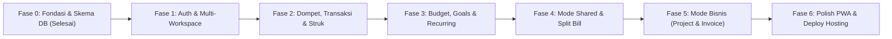

# 05. Roadmap Pengembangan

Roadmap disusun bertahap agar setiap fase langsung menghasilkan fitur yang bisa diuji dan dipakai, sekaligus nyaman untuk proses belajar TypeScript.

## Ringkasan Fase

---

## Fase 0 — Fondasi Project & Skema Database *(Selesai)*
- [x] Setup Fullstack TypeScript (Vite + React + Tailwind v4 + font `Inter` + Hono + Drizzle MySQL).
- [x] Utilitas `src/shared/` (`QuickInput` parser dan helper mata uang *minor unit*).
- [x] Desain & migrasi 19 tabel awal ke MariaDB/MySQL (`0000_zippy_shooting_star.sql`).
- [x] Shell UI responsif + endpoint `GET /api/health` dan `POST /api/utils/parse-quick-input`.

## Fase 1 — Autentikasi & Multi-Workspace Inti *(1A Selesai)*
- [x] Manajemen `sessions` dengan cookie `HttpOnly` dan token SHA-256.
- [x] Halaman Login/Daftar minimal via **Google OAuth** + provisioning **Workspace Pribadi** awal.
- [x] Middleware otorisasi session (`requireAuth`); *lanjutan 1B:* keanggotaan Workspace (`requireWorkspaceRole`).
- [ ] CRUD Workspace (`Personal`, `Shared`, `Business`) beserta kategori default otomatis saat Workspace dibuat.
- [ ] Sistem undangan anggota (`workspace_invites`) via link/token dan penerimaan undangan.

## Fase 2 — Dompet Lintas Ruang, Transaksi Inti & Upload Struk
- [ ] CRUD Dompet (`wallets`) dengan mata uang masing-masing + penautan ke Workspace (`workspace_wallets`) dan toggle `visibility_mode` (`workspace_only` / `full_transparent`).
- [ ] Pencatatan Pemasukan, Pengeluaran, dan Transfer antar dompet dalam DB transaction atomik (menjaga sinkronisasi saldo).
- [ ] Konversi mata uang dompet ke mata uang utama Workspace saat transaksi dicatat.
- [ ] Integrasi **Quick Input** ke form transaksi nyata (autofill hasil parse + edit sebelum simpan).
- [ ] Upload foto struk dengan kompresi otomatis di browser dan route unduh privat berautentikasi.

## Fase 3 — Manajemen Keuangan Pribadi (Budget, Goals & Recurring)
- [ ] Modul **Budgeting per Kategori** bulanan lengkap dengan progress bar dan peringatan mendekati batas.
- [ ] Modul **Goals / Target Tabungan** dan penambahan progres tabungan.
- [ ] Modul **Tagihan Rutin / Recurring** dengan kartu pengingat jatuh tempo & tombol **Konfirmasi Bayar 1-Klik**.

## Fase 4 — Kolaborasi Pasangan & Komunitas (`shared`)
- [ ] Pencatatan **Kas Bersama** dan ringkasan kontribusi anggota.
- [ ] Fitur **Split Bill** (bagi rata maupun nominal custom) dan perhitungan **Settlement** otomatis (*siapa transfer ke siapa*).
- [ ] Halaman **Audit Log** untuk melacak histori pembuatan, pengeditan, dan penghapusan transaksi oleh tiap anggota.

## Fase 5 — Freelancer & UMKM (`business`)
- [ ] Manajemen **Klien** dan **Project** (menghubungkan transaksi pemasukan/biaya ke project tertentu).
- [ ] Dashboard **Profit per Project / Klien** (Omzet − Biaya Operasional = Profit Bersih).
- [ ] Pelacakan **Invoice / Piutang** (`draft`, `sent`, `partial`, `paid`, `overdue`) dan tautan pembayaran ke transaksi masuk.

## Fase 6 — Polish PWA, Hardening & Deploy Shared Hosting
- [ ] Service Worker PWA dasar (caching aset shell & manifest siap install di HP).
- [ ] Uji keamanan end-to-end (akses lintas workspace, batas ukuran file struk, rate limit auth).
- [ ] Deploy ke shared hosting melalui Runtime Manager Node.js dan verifikasi Google OAuth produksi.

---

## Backlog Pasca-MVP (Fase Lanjutan)
- Export laporan ke **Excel / CSV** dan laporan **PDF** (Laba Rugi UMKM & Kas Komunitas).
- Grafik tren arus kas multi-bulan dan perbandingan antar periode.
- Kurs valas otomatis terjadwal dan impor mutasi rekening CSV/Excel.
- Pencarian transaksi lanjutan dan filter multi-kriteria.
